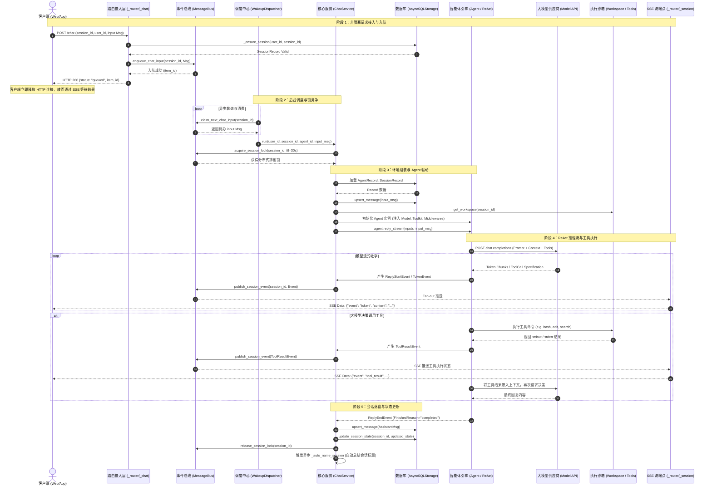
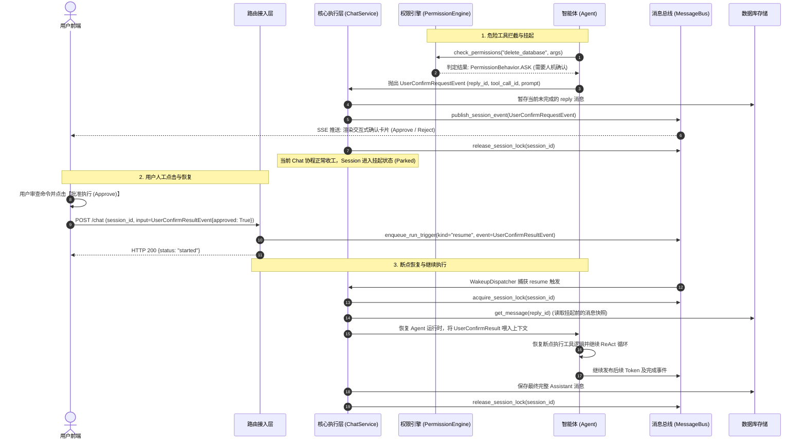
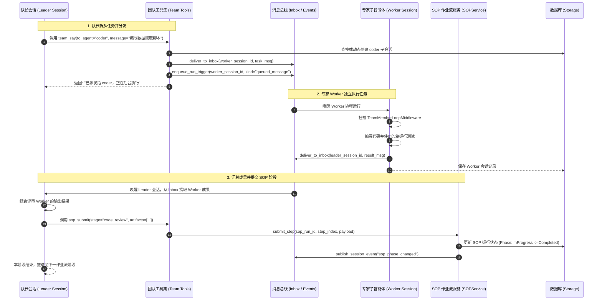

# AgentScope 2.0 当前项目代码深度架构文档

## 一、 系统宏观定位与设计哲学

AgentScope (v2.0.12dev) 是一个面向企业级多智能体系统的工业级应用平台与运行时（Runtime）。它不仅提供了智能体逻辑抽象（Agent、ReAct Loop、Toolkit、Middleware），更内建了一个**基于 FastAPI 的现代化异步服务体系（App Server）**，实现了请求非阻塞接入、分布式事件总线、人机交互协同（HITL）、工作空间沙箱隔离、多通道对接（钉钉、飞书、Discord）以及知识库 RAG。

```
+----------------------------------------------------------------------------------------------------+
|                                    客户端接入层 (Client Ecosystem)                                  |
|   Web UI (Vue/React)  |  Mobile App  |  Channel Webhooks (DingTalk/Feishu)  |  A2A / AG-UI / SSE   |
+----------------------------------------------------------------------------------------------------+
                                                  │
                                                  ▼ (HTTP / SSE / WebRTC)
+----------------------------------------------------------------------------------------------------+
|                              AgentScope 2.0 API 接入层 (FastAPI Layer)                              |
|   /chat        - 非阻塞任务提交 (入 FIFO 队列)       /sessions   - 会话生命周期与 SSE 实时事件流       |
|   /agents      - 智能体配置与定义 CRUD             /workspace  - 文件管理与文件下载鉴权              |
|   /sops        - SOP 标准作业流定义与运行           /channels   - 跨平台通道接入与绑定                |
|   /knowledge   - 知识库与切片索引管理              /realtime   - WebRTC 实时音视频全双工交互          |
+----------------------------------------------------------------------------------------------------+
                                                  │
                                                  ▼
+----------------------------------------------------------------------------------------------------+
|                         核心编排与调度中枢 (Management & Service Core)                             |
|  ┌─────────────────────────┐  ┌──────────────────────────┐  ┌───────────────────────────────────┐  |
|  |     WakeupDispatcher    |  |     ChatRunRegistry      |  |      BackgroundTaskManager        |  |
|  | (消费 chat_inputs FIFO)  |  |   (防重入单飞会话注册表)    |  |       (耗时任务异步脱机执行)       |  |
|  └─────────────────────────┘  └──────────────────────────┘  └───────────────────────────────────┘  |
|                                                 │                                                  |
|  ┌──────────────────────────────────────────────▼───────────────────────────────────────────────┐  |
|  |                                          ChatService                                         |  |
|  |  • 动态组装 Agent、模型、工具与中间件        • 会话级分布式排他锁 (session_run)                |  |
|  |  • 驱动 agent.reply_stream() 生成推理事件    • 事件持久化与扇出 (publish_session_event)          |  |
|  |  • 会话自动语义命名 (_auto_name_session)     • HITL 中断挂起与事件投影 (Projectors)             |  |
|  └──────────────────────────────────────────────────────────────────────────────────────────────┘  |
+----------------------------------------------------------------------------------------------------+
                                                  │
                       ┌──────────────────────────┴──────────────────────────┐
                       ▼                                                     ▼
+---------------------------------------------+       +----------------------------------------------+
|     Agent 运行时引擎 (Agent Runtime Core)    |       |      工具、沙箱与扩展层 (Tools & Sandboxes)    |
| • Agent (ReAct 循环与推理状态机)            |       | • Toolkit (工具集管理与并发隔离)             |
| • ModelConfig (支持主模型 + Fallback 降级)   |       | • PermissionEngine (细粒度权限校验与危险阻断)|
| • Middleware 管道链:                        |       | • Workspaces (隔离执行环境):                 |
|   - InboxMiddleware (跨 Agent 收件箱)       |       |   Local, Docker, Bubblewrap, Daytona,        |
|   - ToolOffloadMiddleware (后台脱机执行)    |       |   E2B, Kubernetes, AppleContainer            |
|   - StateChangeMiddleware (状态追踪)        |       | • MCP Gateway (Model Context Protocol 客户端)|
|   - RAGMiddleware (异构知识库多路召回)      |       | • Skills (动态加载代码技能包)                |
|   - TTSMiddleware (语音合成流式输出)        |       +----------------------------------------------+
+---------------------------------------------+
                       │
                       ▼
+----------------------------------------------------------------------------------------------------+
|                                    数据持久化与事件总线层                                           |
|  ┌──────────────────────────────────────────┐     ┌─────────────────────────────────────────────┐  |
|  |         Storage (唯一事实源存储)          |     |           MessageBus (实时事件总线)         |  |
|  |  • AsyncSQLAlchemyStorage (PG/SQLite/MySQL)|   |  • RedisMessageBus (基于 Redis 流与 Hash)   |  |
|  |    - credentials, agents, sessions, sops |     |    - session_event 流发布订阅               |  |
|  |    - messages (复合主键持久化), teams    |     |    - chat_inputs FIFO 队列与排它锁          |  |
|  |  • RedisStorage (纯内存高速持久化方案)   |     |  • InMemoryMessageBus (单机测试/轻量运行)   |  |
|  └──────────────────────────────────────────┘     └─────────────────────────────────────────────┘  |
+----------------------------------------------------------------------------------------------------+
```

---

## 二、 系统核心模块划分与代码实现映射

### 1. 接入与路由层 (`src/agentscope/app/_router/`)
- **`_chat.py`**: 核心聊天请求接入端点。采用**非阻塞提交设计（Fire-and-Forget）**：
  - `POST /chat`: 客户端提交新消息或 HITL 确认结果。不直接等待 LLM 生成，而是将消息压入 `chat_inputs` FIFO 队列，立即返回 HTTP 200 `ChatTriggerResponse(status="queued")`。
  - `GET /chat/queue`: 获取当前会话正在排队的未处理消息。
  - `PATCH /chat/queue/order` 与 `DELETE /chat/queue/{item_id}`: 支持在 Agent 尚未开工前重排或撤销待办对话。
- **`_session.py`**: 会话状态与实时事件出口：
  - `GET /sessions/{session_id}/stream`: 基于 **HTTP SSE (Server-Sent Events)** 的长连接，前端通过该连接单向实时接收 Agent 产生的 Token 流、工具调用进度、HITL 确认卡片及运行完成状态。
- **`_workspace.py`**: 工作空间文件访问与安全令牌下载机制（`download_secret` 签发有时效的下载凭证，防止未授权访问）。
- **`_channel.py`**: 跨平台 Bot 网关，接收并调度来自钉钉、飞书、Discord 的 Webhook 触发。

### 2. 调度中枢与生命周期管理 (`src/agentscope/app/_manager/` & `_service/`)
- **`WakeupDispatcher` (`_wakeup_dispatcher.py`)**: 
  - 维持后台异步主协程循环，监听全局运行触发信号。
  - 负责从 `chat_inputs` FIFO 队列中按顺序弹出待执行轮次，避免同会话并发产生状态错乱，调用 `ChatService.run()`。
- **`ChatRunRegistry` (`_chat_run_registry.py`)**:
  - 进程级会话并发防重入注册表，保证同一会话在单实例内只有一个正在活跃执行的 asyncio 任务。
- **`ChatService` (`_service/_chat.py`)**:
  - 执行引擎的核心中枢。单次运行（`run()`）包含严密的 7 个阶段：
    1. **会话排它锁竞争**: 通过 `MessageBus.session_run` 获取分布式锁（防止集群多实例同时处理同会话）。
    2. **环境解析与装配**: 加载 AgentRecord、SessionRecord、Team 上下文、ModelConfig 与 Workspace 沙箱。
    3. **中间件流水线挂载**: 按序串联 `InboxMiddleware`、`StateChangeMiddleware`、`ToolOffloadMiddleware`、`RAGMiddleware`、`TTSMiddleware` 等。
    4. **工具箱（Toolkit）编译**: 将基础文件工具、沙箱命令、外部技能、MCP 工具及团队协作工具打包。
    5. **启动 Agent 思考循环**: 调用 `agent.reply_stream()`，以异步生成器模式逐帧捕获事件。
    6. **事件广播与持久化**: 每产生一个事件立即写入 `MessageBus`（供 SSE 消费），并在结束时将整条 `AssistantMsg` 与状态更新回 Storage。
    7. **自动命名触发**: 首轮对话完成后，调用小模型异步总结生成 Session 标题。

### 3. 智能体与执行引擎 (`src/agentscope/agent/`, `model/`, `tool/`)
- **`Agent` (`agent/_agent.py`)**: 经典的 ReAct 驱动循环。维护上下文消息列表、调用大模型做决策、解析函数调用（Function Calling）、分发给 Toolkit 执行，支持 `tool_stop` 与人工中断退出。
- **`Model` (`model/`)**: 适配主流商业与开源模型（Anthropic Claude, Google Gemini, OpenAI, DashScope, DeepSeek, Ollama 等），统一了消息格式、流式 Token 产生与结构化输出。
- **`WorkspaceManager` (`workspace_manager/`)**:
  - 实现了多种级别的环境隔离：`LocalWorkspaceManager`（本地进程文件空间）、`DockerWorkspaceManager`（容器级隔离）、`BubblewrapWorkspaceManager`（Linux 命名空间隔离）、`Daytona`、`E2B`（云端微虚拟机沙箱）、`Kubernetes` 等。

### 4. 存储与状态总线 (`src/agentscope/app/storage/` & `message_bus/`)
- **`AsyncSQLAlchemyStorage` (`storage/_sql/`)**:
  - 基于 SQLAlchemy 2.0 异步 ORM。将关键关系字段（`user_id`, `agent_id`, `created_at` 等）提升为索引列，其余可扩展数据序列化到 JSON 列 `payload`。
  - 核心表结构：`credentials`、`agents`、`sessions`、`messages`（以 `session_id + msg_id` 为联合主键）、`knowledge_bases`、`knowledge_documents`、`sops`、`sop_runs`、`teams`。
- **`MessageBus` (`message_bus/`)**:
  - 提供分布式信号协调：`session_event`（事件流发布/重放）、`chat_inputs`（对话排队）、`registry`（活跃状态注册）及分布式会话互斥锁。

---

## 三、 核心架构时序图 (Architectural Sequence Diagrams)

### 时序图 1：端到端聊天请求与异步流式执行时序 (End-to-End Chat Flow)

这是 AgentScope 中最核心的数据与控制流。它展现了用户发起一条聊天请求后，系统如何通过“非阻塞入队 -> 调度器唤醒 -> 分布式锁控制 -> Agent 推理与沙箱执行 -> SSE 流式推送 -> 数据库落地”完成闭环：



---

### 时序图 2：人机协同 (HITL) 权限中断与挂起恢复时序 (Human-in-the-Loop Resumption)

当 Agent 执行危险操作（如删除核心文件、运行高危脚本），PermissionEngine 会拦截并产生挂起事件，等待前端人工确认后断点续传：



---

### 时序图 3：多智能体团队协作与 SOP 阶段扭转时序 (Multi-Agent & SOP Workflow)

展示了 Team Leader 启动 Worker 子 Agent，通过收件箱（Inbox）异步消息交换，最终通过 SOP 阶段提交工具完成流程扭转：



---

## 四、 当前项目架构的核心特征与潜在局限

1. **分布式组件强绑定 Redis**:
   - 当前集群环境强依赖 `RedisMessageBus` 进行排他锁竞争、会话输入队列（`chat_inputs`）和事件流的分发。如果移除 Redis，单机模式只能退化为不支持多进程并发的 `InMemoryMessageBus`。
2. **多租户（Multi-Tenancy）支持仅停留在 `user_id` 级别**:
   - `deps.py` 中虽然规划了 JWT，但目前完全由 `X-User-ID` 单一标识驱动。数据库表结构缺乏顶层 `tenant_id` 强隔离，无行级安全策略（RLS），也未对多企业租户的 Token 配额、私有知识库进行硬性隔离。
3. **文件流中转消耗服务器网络与内存**:
   - 知识库与文件上传目前依赖服务端 FastAPI 中转存储到本地/BlobStore，缺乏直接生成云对象存储（S3/MinIO）预签名直传（Presigned URL）的非阻塞架构。
4. **工具参数防幻觉依赖基础机制**:
   - 工具基类（`ToolBase`）通过 JSONSchema 或静态检查进行参数检验，但在遇到复杂的大模型生成参数幻觉时，缺乏一层前置的、标准化的 Pydantic 运行时严格结构体“防弹衣”防御与结构化自愈机制。
